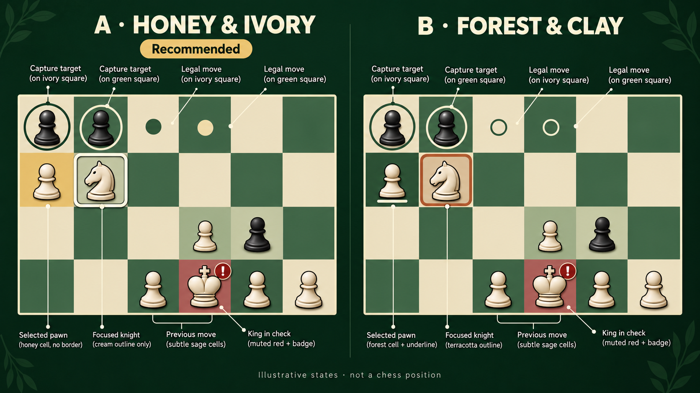

# Gameplay highlight exploration v6

The built-in ImageGen tool generated this comparison sheet. It is design inspiration, not a gameplay capture.

## References and decision

The actual app screenshot is [chess-selection.png](../evidence/audio-motion-v5/chess-selection.png). The original style reference is [chess-forest-ivory.png](../concepts/imagegen/chess-forest-ivory.png). The exact generation prompt is in [prompt.txt](prompt.txt).

The user approved direction A, Honey & Ivory. The user then explicitly rejected circles around pieces and chose background highlights. That correction overrides the sheet's dots, capture rings, and check badge. The production renderer uses cell backgrounds for every game state. One rounded square marks remote focus.

The generator introduced softer board shading, extra focus edging, and imprecise label positions. Those details are not implementation requirements. Generated piece positions are illustrative and have no chess-rule meaning.

The earlier renderer combined dark under-strokes, a sage-gold selection box, and a separate amber focus box. These concentric frames competed with the piece silhouette. Teal move markers added another accent. The approved implementation removes these frames and markers.

## Production colors and geometry

The implementation is in [ChessBoardView.java](../../../apps/chess-math/src/main/java/com/amine/chessmath/ChessBoardView.java). The table gives the exact ARGB literals. Rounded opacity percentages are included for reference. Every state fill covers the entire cell behind the piece.

| State | ARGB on ivory / green | Color and approximate opacity |
| --- | --- | --- |
| Base square | 0xFFEEE3C8 / 0xFF486A4D | Ivory / green, 100% |
| Selected source | 0x7AE6B85C / 0x9EE6B85C | Honey #E6B85C, 48% / 62% |
| Empty legal destination | 0x667D956F / 0x7AF4E5BF | Sage #7D956F, 40% / cream #F4E5BF, 48% |
| Legal capture | 0xA3E6B85C / 0xC2E6B85C | Honey #E6B85C, 64% / 76% |
| Previous move source and target | 0x38ACC2A1 / 0x38ACC2A1 | Sage #ACC2A1, 22% |
| King in check | 0x94B95746 / 0x94B95746 | Brick #B95746, 58% |
| Remote focus | 0xFF173D2A / 0xFFFFF1D0 | Forest / cream, 100% |

Remote focus uses one continuous rounded-square outline. Its stroke is 3.5% of the cell width. Its inset is 5%, and its corner radius is 6%. The color follows the original square color. There is no dark under-stroke or inner selection outline.

## Drawing order

The renderer draws the original square first. It chooses one background with this priority, from lowest to highest: previous move, legal destination or capture, selected source, check. It then draws that background once. State colors do not accumulate.

Pieces draw above the background. The single remote focus outline draws last. The selected source remains highlighted when the cursor moves to a destination. Focus on that source adds only the remote outline. Focus on a capture target combines the capture background with the same remote outline.

There are no legal dots, capture rings, circles around pieces, nested frames, or check badges. Background colors express game state. The remote outline identifies the navigation cursor.

The sheet records the earlier exploration. Use real app captures to assess the final background-only rendering. Source changes and rendering tests do not establish physical TV appearance.
